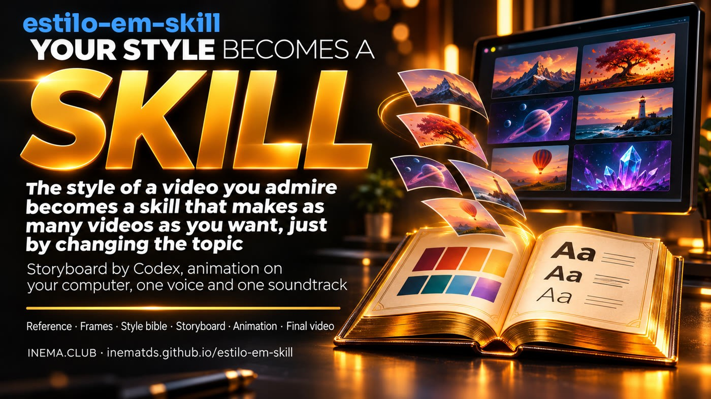
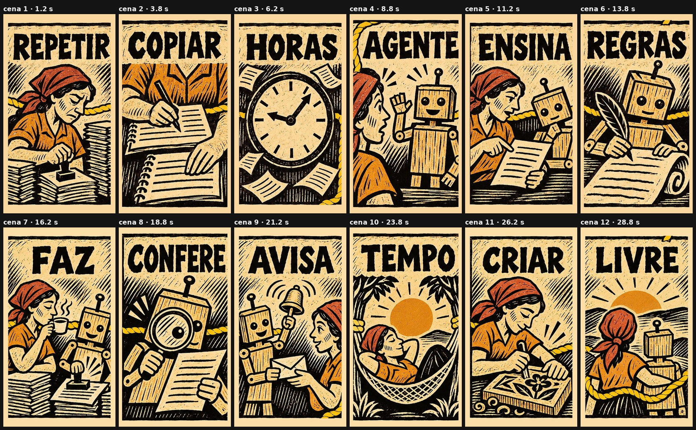

# style-to-skill: every video in your style, just change the topic

[](https://inematds.github.io/estilo-em-skill/guia/en/)

**🇧🇷 [Português](README.md) · 🇺🇸 [English](README.en.md) · 🇪🇸 [Español](README.es.md)**

## What it is

You see a video with a visual style you love, try to repeat it, and every video you make turns out looking different. **style-to-skill** is a free kit that studies the visual language of that video (colors, lettering, composition, movement) and saves everything in a skill, an instruction file that Claude Code or Codex follows. Then you just tell it the topic, and the skill makes the whole video with the same look: storyboard, animated scenes, narration in one voice, a soundtrack, and a review before it says “ready.” It’s for people who make short videos and don’t program; you need Claude Code or Codex, an image generation tool, and three free programs on your computer.

## 📖 User guide

Complete guide (landing page + step-by-step instructions): **https://inematds.github.io/estilo-em-skill/guia/en/**

🎬 Video: https://www.youtube.com/watch?v=bphIJzdykNU · Short: https://youtube.com/shorts/mSEYJ8zA-zU



## How it works

An open toolkit that turns the **style** (not the content) of a reference video into a reusable **skill**. Once installed, you provide just five details (topic, format, duration, resolution, and engine), and the skill plans the scenes, draws the storyboard in the style, writes the narration, animates it, adds a single music track, and delivers `final/video-final.mp4` + `final/manifesto.json`, **checked by a script** before it says “done.”

**reference video → frames chosen automatically → AI writes the “style bible” → skill installed
→ storyboard (up to 6 scenes of 2.5 s) → animated scenes → narration in one voice → single music track → video + manifest + validation**

## Who it’s for

For people who make videos (reels, shorts, explainers), are 30 or older, don’t program, and already use **Claude Code** or **Codex**. You don’t need to write code: just copy commands and talk with the AI.

## What you need

| what | why | how to check |
|---|---|---|
| Claude Code **or** Codex | view the frames, write the style bible, run the skill, generate the storyboard | open in the terminal |
| ffmpeg (includes ffprobe) | cut, animate, join, and measure the audio | `ffmpeg -version` |
| Python 3 | run the scripts | `python3 --version` |
| Pillow | work with images | `python3 -c "import PIL"` (install on Ubuntu: `sudo apt install python3-pil`; on Mac: `brew install pillow`) |
| a voice | narration | record it yourself, or use local TTS (optional: edge-tts) |
| your own music or properly licensed music | soundtrack | an `.mp3`/`.wav` |

For the storyboard, you need an image generation tool (in Codex, the subscription `image_gen`).

## The process, from start to finish

Key: 🧠 you with the AI · ⚙️ script · 🤖 the skill (the AI following `SKILL.md`)

| # | step | command | who |
|---|---|---|---|
| 1 | Choose the reference video (the style you want) | — | 🧠 |
| 2 | Extract 5–8 different frames + a contact sheet | `python3 scripts/quadros.py ref.mp4 --n 8 --saida estilo/quadros/` | ⚙️ |
| 3 | The AI looks at the frames and writes the style bible (hex palette, typography, composition, what to avoid…) | paste `prompts/criar-skill.md` (in Portuguese) into Claude Code/Codex | 🧠 |
| 4 | Install the skill with the style bible | `bash scripts/instalar.sh meu-estilo claude --estilo estilo/estilo.md` (or `codex`) | ⚙️ |
| 5 | Request the video: topic, format, duration, resolution, engine | “use the skill meu-estilo for a video about …” | 🧠 |
| 6 | Calculate scenes and storyboards → `saida/plano.json` | `cenas.py --tema … --duracao 30 --formato 9:16` | 🤖⚙️ |
| 7 | Write the script (up to 6 spoken words per scene, one keyword per scene) | `roteiro.json` + `cenas.py … --roteiro roteiro.json` | 🤖 |
| 8 | Build each storyboard prompt from the template + style bible | `pedido_storyboard.py` | ⚙️ |
| 9 | Generate the storyboards, one at a time (the second uses the first as a reference), and LOOK at each one | image tool → `saida/storyboards/storyboard-N.png` | 🤖🧠 |
| 10 | Crop into panels in the video format | `recortar.py --plano saida/plano.json` | ⚙️ |
| 11 | Animate (local engine: slow zoom/pan + dissolve) | `animar.py` | ⚙️ |
| 12 | Narrate in one voice, timed to the scenes | `narrar.py --arquivo voz.wav` (or `--falas-dir`, `--comando`, `--inemavox`) | ⚙️ |
| 13 | Add one soundtrack with ducking + final video + manifest | `montar.py` | ⚙️ |
| 14 | Check the result and look at the final contact sheet | `validar.py --duracao 30 --resolucao 1080x1920` and `folha.py` | ⚙️🧠 |
| 15 | Improve the skill based on what went wrong | note it in `references/licoes.md` and change the rule | 🧠 |

Commands for steps 6 to 14 are in `<skill>/scripts/` (e.g., `.claude/skills/meu-estilo/scripts/`).
The skill runs everything on its own; the table shows what happens so you can understand it and run it by hand.

## Scenes and storyboards

Each scene lasts **2.5 s**; each storyboard has **up to 6 scenes** (15 s). Longer videos need several storyboards, generated one at a time to maintain continuity. Durations that aren’t multiples of 2.5 are rounded to the nearest one, with a notice (17 s → 17.5 s).

| duration | scenes | storyboards | grid (9:16) |
|---|---|---|---|
| 10 s | 4 | 1 | 2 × 2 |
| 15 s | 6 | 1 | 2 × 3 |
| 20 s | 8 | 2 | 2 × 2 + 2 × 2 |
| 30 s | 12 | 2 | 2 × 3 + 2 × 3 |
| 45 s | 18 | 3 | 2 × 3 × 3 |

In 16:9, the full grid is 3 rows × 2 columns (the contact sheet is nearly square in both cases).

## Engines

| engine | status | what it does |
|---|---|---|
| `local` | **tested** | free, with no AI video: each panel gets a slow camera movement (zoom up to 1.25×, pan), and the scenes are joined with a dissolve at the exact duration |
| `kling` | **not tested in this toolkit** | `animar.py --motor kling --so-prompts` writes the `kling image_to_video` commands for each scene for you to run in YOUR account |
| `seedance` / `higgsfield` | **not tested in this toolkit** | `animar.py --motor seedance --so-prompts` writes one prompt per storyboard (scene timing, camera, text, transition, speech, “no music”) for you to paste into the site |

The toolkit doesn’t call any APIs. For AI engines, you run them yourself, using your own account.

## What the toolkit guarantees (and tests)

- `quadros.py` automatically selects **different** frames: scene changes detected by ffmpeg + removal of similar frames
  (drawing and color); videos with few scene changes fall back to evenly spaced frames.
- `recortar.py` finds the gutter between panels (light or dark, even when the connecting thread crosses it) and, if it can’t,
  crops to a fixed grid; supports partial grids; adds padding so the zoom doesn’t crop the word.
- `animar.py` doesn’t shorten the video because of the dissolve (a requested 30 s = 30 s delivered).
- `narrar.py` trims silence from the start and end, speeds up by up to 15% if needed, warns when the speech won’t fit, and **rejects silent audio**.
- `montar.py` uses ONE soundtrack from start to finish (it doesn’t restart), sets volume to 0.5, lowers it under the voice (ducking), and fades it out at the end;
  without a track it stops and asks; with multiple tracks, it asks you to choose.
- `validar.py` checks the manifest files, duration ±0.5 s, resolution, video + audio, audio and narration that
  aren’t silent, presence of a soundtrack, and `status: completo`. If anything fails, it exits with an error and says what’s missing.

Tests: `bash tests/rodar.sh` (no pytest; synthetic images and sine tones instead of voice and music; 24/24 passing on Ubuntu).

The toolkit was built and tested on Linux (Ubuntu). It hasn’t been tested on Mac: `scripts/instalar.sh` uses Linux’s `sed -i`, and `tests/rodar.sh` uses `timeout`; to install the skill on Mac, follow the manual steps in the guide (step 4).

## The demo: cordel

To avoid using frames from someone else’s video, the demo’s reference style is **original**: 6 cordel woodcut frames (cream paper, solid black, ochre and earthy red, carved lettering, and a yellow thread connecting the scenes) created for this toolkit and assembled into a short video
(`exemplos/cordel/referencia/referencia.mp4`). Then the complete workflow ran:

- `estilo/quadros/` + `folha.jpg`: the frames that `quadros.py` selected automatically
- `estilo/estilo.md`: the style bible filled in using the toolkit’s prompt
- `skill/`: the installed `cordel` skill
- `saida/storyboards/`: the 2 storyboards (and the prompts assembled by the skill), `saida/paineis/`: the 12 panels
- `saida/plano.json`, `final/manifesto.json`, `final/video-final.mp4`, `final/folha-final.jpg`
- `LICOES.md` (in Portuguese): what went wrong between attempts and what changed in the skill

Topic: “How an AI agent takes repetitive work out of your day” — 30 s, 9:16, 1080×1920, 12 scenes,
2 storyboards, local engine, local voice, original soundtrack.

Result (checked by `validar.py`):

```
  ok   manifesto com status completo
  ok   30 arquivos do manifesto existem
  ok   duração 30.00 s (pedido 30 s ± 0,5)
  ok   resolução 1080x1920
  ok   áudio do vídeo com som (média -20.2 dB, pico -3.9 dB)
  ok   narração com voz (média -18.9 dB)
PASSOU: vídeo conferido, pode dizer pronto.
```

- MP4: 30.0 s, 1080×1920, 30 fps, H.264 + AAC, 23 MB. Local render (engine `local`): 78 s on this machine.
- Voice: local TTS (chatterbox, cloning a reference voice), 12 lines, none longer than the scene. Local voice
  sometimes invents a short bit after the sentence: `narrar.py` regenerated lines that were too long, trimmed quiet tails, and scene 3 was redone on its own with `--refazer 3`. All 12 lines, checked against a local transcript
  (Whisper, `saida/voz/transcricao-conferencia.srt`), match the script.
- Soundtrack: `assets/trilha/energia.mp3` (original), volume 0.5, lowered under the voice.
- The repository includes the panels as JPGs (`paineis-jpg/`); the PNGs, clips, and silent video are generated again
  when you run it. So in a clone, check with `python3 skill/scripts/validar.py --sem-intermediarios`.

## Improve the skill after each test

The skill isn’t ready from the start. After each video, look at the final contact sheet and note in `references/licoes.md` what went wrong. If the same error happens again, **change the rule** (in the style bible, storyboard rules, or script), not just the prompt. In the demo, asking for a “word no more than 60% of the width” didn’t work twice; the fix that worked was in the script (`--respiro`). See `exemplos/cordel/LICOES.md` (in Portuguese).

## Honest limitations

- **Storyboard resolution**: the image tool delivers about 1254×1254 per storyboard; each panel comes out around 370×600 px and is enlarged to 1080×1920. Flat styles (engraving, cutout, flat) hold up well; styles with lots of fine detail look soft.
- **Drawn text** depends on the image tool: zoom in and check each word. Short words without accents are less likely to be wrong.
- **The local engine doesn’t animate the drawing**: it moves the camera around the illustration + dissolve. To make characters actually move, use an AI video engine (not tested here).
- **edge-tts** uses an online service and hasn’t been tested in this toolkit; the demo used local TTS. The `--inemavox` mode calls `tts_direct.py` from a local inemavox installation; its HTTP API (port 8010) hasn’t been implemented.
- **Local voices may invent sounds**: tail trimming is conservative (it only removes sounds that are much quieter or very short).
  A loud “sound” without a word after the sentence is caught only by listening or transcribing; then use `--refazer N`.
- **Continuity** between storyboards is requested (the previous one is used as a reference), but not guaranteed: check it.
- The AI writes the style bible by looking at frames: check the colors and “what to avoid” before using it.
- Use only references and music you’re allowed to use. The method copies the visual language, not characters, logos,
  or text.

## Structure

```
scripts/quadros.py, scripts/instalar.sh      ← steps 2 and 4
prompts/criar-skill.md                       ← step 3
molde/estilo-em-skill/                       ← the skill (SKILL.md, references/, modelos/, scripts/)
tests/rodar.sh                               ← tests
exemplos/cordel/                             ← the complete demo
```

## License

MIT © 2026 INEMA
