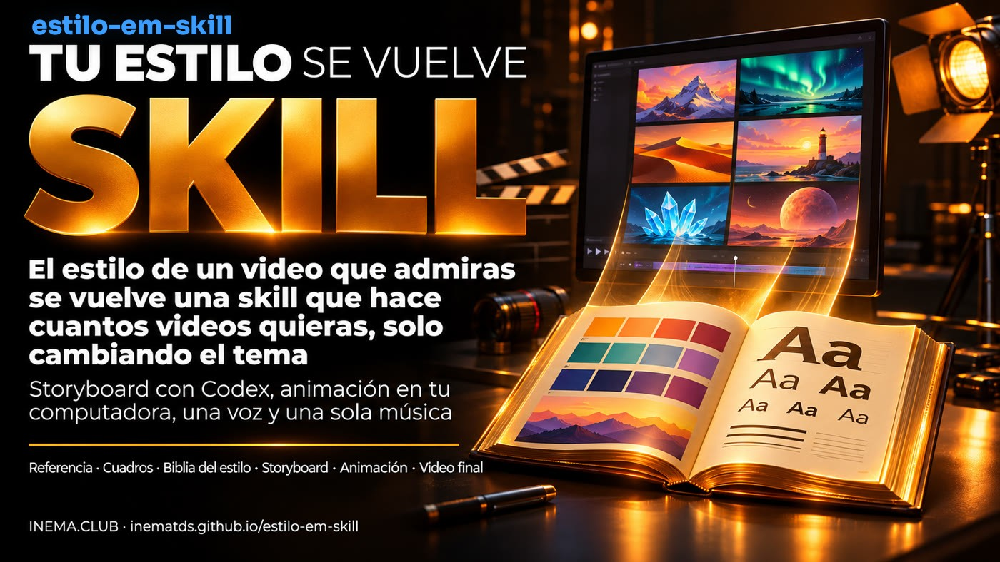
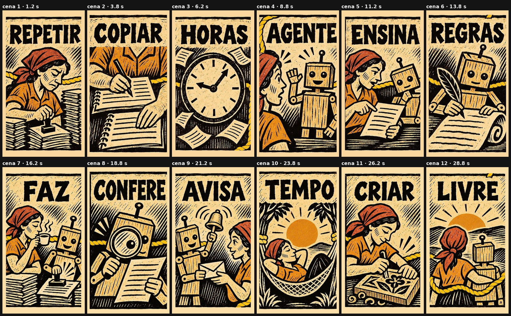

# estilo en skill: todos tus videos con el mismo estilo, cambiando solo el tema

[](https://inematds.github.io/estilo-em-skill/guia/es/)

**🇧🇷 [Português](README.md) · 🇺🇸 [English](README.en.md) · 🇪🇸 [Español](README.es.md)**

## Qué es

Ves un video con un estilo visual que te encanta, intentas repetirlo y cada video tuyo termina con una apariencia diferente. **estilo en skill** es un kit gratis que estudia el lenguaje visual de ese video (colores, letras, composición, movimiento) y guarda todo en una skill, un archivo de instrucciones que Claude Code o Codex sigue. Después solo dices el tema y la skill hace el video completo con la misma apariencia: storyboard, escenas animadas, narración con una sola voz, música de fondo y una revisión antes de decir «listo». Es para quienes crean videos cortos y no programan; necesitas Claude Code o Codex, una herramienta que genere imágenes y tres programas gratis en la computadora.

## 📖 Guía de uso

Guía completa (página de presentación + paso a paso): **https://inematds.github.io/estilo-em-skill/guia/es/**

🎬 Video: https://www.youtube.com/watch?v=bphIJzdykNU · Short: https://youtube.com/shorts/mSEYJ8zA-zU



## Cómo funciona

Un kit abierto que convierte el **estilo** (no el contenido) de un video de referencia en una **skill**
reutilizable. Después de instalarla, solo ingresas cinco datos (tema, formato, duración, resolución y motor) y la
skill planifica las escenas, diseña el storyboard con ese estilo, escribe la narración, anima, añade una sola pista musical y
entrega `final/video-final.mp4` + `final/manifesto.json`, **revisados por un script** antes de decir «listo».

**video de referencia → selección automática de cuadros → la IA escribe la «biblia del estilo» → skill instalada
→ storyboard (hasta 6 escenas de 2,5 s) → escenas animadas → narración con una sola voz → una pista musical → video + manifiesto + validación**

## Para quién

Para quienes crean videos (reels, shorts, explicativos), tienen más de 30 años, no programan y ya usan
**Claude Code** o **Codex**. No necesitas escribir código: copias comandos y conversas con la IA.

## Qué necesitas

| qué | para qué | cómo comprobarlo |
|---|---|---|
| Claude Code **o** Codex | ver los cuadros, escribir la biblia, ejecutar la skill, generar el storyboard | abrir en la terminal |
| ffmpeg (incluye ffprobe) | cortar, animar, unir y medir el audio | `ffmpeg -version` |
| Python 3 | ejecutar los scripts | `python3 --version` |
| Pillow | editar imágenes | `python3 -c "import PIL"` (instalar en Ubuntu: `sudo apt install python3-pil`; en Mac: `brew install pillow`) |
| una voz | narración | la grabas tú o usas un TTS local (opcional: edge-tts) |
| música propia o con licencia | pista musical | un archivo `.mp3`/`.wav` |

Para el storyboard necesitas una herramienta que genere imágenes (en Codex, `image_gen`, incluida en la suscripción).

## El proceso, de principio a fin

Leyenda: 🧠 tú con la IA · ⚙️ script · 🤖 la skill (la IA sigue el `SKILL.md`)

| # | paso | comando | quién |
|---|---|---|---|
| 1 | Elige el video de referencia (el estilo que quieres) | — | 🧠 |
| 2 | Extrae entre 5 y 8 cuadros diferentes + una hoja de contacto | `python3 scripts/quadros.py ref.mp4 --n 8 --saida estilo/quadros/` | ⚙️ |
| 3 | La IA mira los cuadros y escribe la biblia del estilo (paleta hexadecimal, tipografía, composición, qué evitar…) | pegar `prompts/criar-skill.md` (en portugués) en Claude Code/Codex | 🧠 |
| 4 | Instala la skill con la biblia | `bash scripts/instalar.sh meu-estilo claude --estilo estilo/estilo.md` (o `codex`) | ⚙️ |
| 5 | Pide el video: tema, formato, duración, resolución y motor | «usa la skill meu-estilo para un video sobre…» | 🧠 |
| 6 | Calcula escenas y storyboards → `saida/plano.json` | `cenas.py --tema … --duracao 30 --formato 9:16` | 🤖⚙️ |
| 7 | Escribe el guion (hasta 6 palabras habladas por escena, una palabra clave por escena) | `roteiro.json` + `cenas.py … --roteiro roteiro.json` | 🤖 |
| 8 | Prepara el pedido de cada storyboard a partir del molde + la biblia | `pedido_storyboard.py` | ⚙️ |
| 9 | Genera los storyboards, uno a la vez (el segundo usa el primero como referencia), y REVISA cada uno | herramienta de imágenes → `saida/storyboards/storyboard-N.png` | 🤖🧠 |
| 10 | Recorta en paneles con el formato del video | `recortar.py --plano saida/plano.json` | ⚙️ |
| 11 | Anima (motor local: zoom/paneo lento + disolvencia) | `animar.py` | ⚙️ |
| 12 | Añade la narración con una sola voz, ajustada a las escenas | `narrar.py --arquivo voz.wav` (o `--falas-dir`, `--comando`, `--inemavox`) | ⚙️ |
| 13 | Añade una sola pista musical con ducking + video final + manifiesto | `montar.py` | ⚙️ |
| 14 | Comprueba el resultado y revisa la hoja final | `validar.py --duracao 30 --resolucao 1080x1920` y `folha.py` | ⚙️🧠 |
| 15 | Mejora la skill con lo que salió mal | anota en `references/licoes.md` y cambia la regla | 🧠 |

Los comandos de los pasos 6 al 14 están en `<skill>/scripts/` (por ejemplo, `.claude/skills/meu-estilo/scripts/`).
La skill ejecuta todo esto por sí sola; la tabla te muestra lo que ocurre y te permite hacerlo manualmente.

## Escenas y storyboards

Cada escena dura **2,5 s**; cada storyboard tiene **hasta 6 escenas** (15 s). Para videos más largos se usan varios storyboards,
generados uno a la vez para mantener la continuidad. Si la duración no es múltiplo de 2,5, se redondea al valor más
cercano, con un aviso (17 s → 17,5 s).

| duración | escenas | storyboards | cuadrícula (9:16) |
|---|---|---|---|
| 10 s | 4 | 1 | 2 × 2 |
| 15 s | 6 | 1 | 2 × 3 |
| 20 s | 8 | 2 | 2 × 2 + 2 × 2 |
| 30 s | 12 | 2 | 2 × 3 + 2 × 3 |
| 45 s | 18 | 3 | 2 × 3 × 3 |

En 16:9 la cuadrícula completa es de 3 filas × 2 columnas (la hoja queda casi cuadrada en ambos casos).

## Motores

| motor | estado | qué hace |
|---|---|---|
| `local` | **probado** | gratis, sin IA de video: cada panel recibe un movimiento de cámara lento (zoom hasta 1,25×, paneo) y las escenas se conectan con disolvencias, con la duración exacta |
| `kling` | **no probado en este kit** | `animar.py --motor kling --so-prompts` escribe los comandos `kling image_to_video` de cada escena para que los ejecutes en TU cuenta |
| `seedance` / `higgsfield` | **no probado en este kit** | `animar.py --motor seedance --so-prompts` escribe un prompt por storyboard (duración de cada escena, cámara, texto, transición, diálogo, «sin música») para pegar en el sitio |

El kit no llama a ninguna API. En los motores de IA, tú haces la ejecución en tu cuenta.

## Qué garantiza y prueba el kit

- `quadros.py` elige automáticamente cuadros **diferentes**: detecta cambios de escena en ffmpeg y descarta cuadros parecidos
  (por dibujo y color); si el video tiene pocos cambios, selecciona cuadros espaciados.
- `recortar.py` encuentra el canal entre los paneles (claro u oscuro, incluso si la línea conductora lo cruza) y, si no
  lo encuentra, recorta con una cuadrícula fija; admite cuadrículas parciales; añade margen para que el zoom no corte la palabra.
- `animar.py` no acorta el video con la disolvencia (si pides 30 s, entrega 30 s).
- `narrar.py` elimina el silencio de los extremos, acelera hasta un 15 % si hace falta, avisa cuando el diálogo no cabe y **rechaza voces sin sonido**.
- `montar.py` usa UNA pista musical de principio a fin (no la reinicia), con volumen 0,5, la baja mientras suena la voz (ducking) y aplica un fundido al final;
  si no hay pista musical, se detiene y pregunta; si hay varias, pide que elijas.
- `validar.py` comprueba los archivos del manifiesto, la duración ±0,5 s, la resolución, el video + audio, el audio y la narración (que
  no estén en silencio), que haya una pista musical y que el `status: completo`. Si algo falla, muestra un error e indica qué falta.

Pruebas: `bash tests/rodar.sh` (sin pytest; imágenes sintéticas y tonos sinusoidales en lugar de voz y música; 24/24 aprobadas en Ubuntu).

El kit se creó y probó en Linux (Ubuntu). No se probó en Mac: `scripts/instalar.sh` usa el `sed -i` de Linux y `tests/rodar.sh` usa `timeout`; para instalar la skill en Mac, sigue el método manual de la guía (paso 4).

## La demo: cordel

Para no usar cuadros de video de otras personas, la demo tiene un estilo de referencia **propio**: 6 cuadros de
xilografía de cordel (papel crema, negro sólido, ocre y rojo terroso, letras talladas y una línea
amarilla que conecta las escenas), generados para este kit y unidos en un video corto
(`exemplos/cordel/referencia/referencia.mp4`). Luego se ejecutó todo el proceso:

- `estilo/quadros/` + `folha.jpg`: los cuadros que `quadros.py` eligió automáticamente
- `estilo/estilo.md`: la biblia completada con el prompt del kit
- `skill/`: la skill `cordel` instalada
- `saida/storyboards/`: los 2 storyboards (y los pedidos preparados por la skill), `saida/paineis/`: los 12 paneles
- `saida/plano.json`, `final/manifesto.json`, `final/video-final.mp4`, `final/folha-final.jpg`
- `LICOES.md`: qué salió mal en los intentos y qué cambió en la skill

Tema: «Cómo un agente de IA te quita las tareas repetitivas del día» — 30 s, 9:16, 1080×1920, 12 escenas,
2 storyboards, motor local, voz local, pista musical propia.

Resultado (comprobado con `validar.py`):

```
  ok   manifesto com status completo
  ok   30 arquivos do manifesto existem
  ok   duração 30.00 s (pedido 30 s ± 0,5)
  ok   resolução 1080x1920
  ok   áudio do vídeo com som (média -20.2 dB, pico -3.9 dB)
  ok   narração com voz (média -18.9 dB)
PASSOU: vídeo conferido, pode dizer pronto.
```

- MP4: 30,0 s, 1080×1920, 30 fps, H.264 + AAC, 23 MB. Renderizado local (motor `local`): 78 s en esta máquina.
- Voz: TTS local (chatterbox, clonando una voz de referencia), 12 diálogos, ninguno más largo que su escena. A veces la voz
  local inventa un fragmento después de la frase: `narrar.py` volvió a generar los diálogos demasiado largos, recortó las colas
  de bajo volumen y la escena 3 se volvió a generar con `--refazer 3`. Las 12 frases, comprobadas con una transcripción local
  (Whisper, `saida/voz/transcricao-conferencia.srt`), coinciden con el guion.
- Pista musical: `assets/trilha/energia.mp3` (propia), volumen 0,5, atenuada mientras suena la voz.
- En el repositorio quedan los paneles en JPG (`paineis-jpg/`); los PNG, los clips y el video sin sonido se vuelven a generar
  al ejecutar el proceso. Por eso, al clonar el repositorio, comprueba con `python3 skill/scripts/validar.py --sem-intermediarios`.

## Mejora la skill después de cada prueba

La skill no sale perfecta desde el principio. Después de cada video, revisa la hoja final y anota en `references/licoes.md` qué
salió mal. Si el error vuelve a ocurrir, **cambia la regla** (en la biblia, en las reglas del storyboard o en el script), no solo
el pedido. En la demo, pedir «palabra de no más del 60 % del ancho» no funcionó dos veces; la solución que
funcionó fue cambiar el script (`--respiro`). Consulta `exemplos/cordel/LICOES.md` (en portugués).

## Límites con honestidad

- **Resolución del storyboard**: la herramienta de imágenes entrega unos 1254×1254 por storyboard; cada panel
  queda en unos 370×600 px y se amplía a 1080×1920. Los estilos planos (grabado, recorte, flat) funcionan bien; los estilos con muchos detalles finos pierden nitidez.
- **El texto dibujado** depende de la herramienta de imágenes: revisa cada palabra con zoom. Las palabras cortas y sin
  tilde tienen menos errores.
- **El motor local no anima el dibujo**: la cámara recorre la ilustración + disolvencia. Para que los personajes se muevan de verdad, usa un motor de IA de video (no probado aquí).
- **edge-tts** usa un servicio en línea y no se probó en este kit; la demo usó TTS local. El modo `--inemavox`
  llama a `tts_direct.py` de una instalación local de inemavox; la API HTTP (puerto 8010) no está implementada.
- **La voz local inventa sonidos**: el recorte de la cola es conservador (solo elimina lo que suena mucho más bajo o dura muy poco).
  Un sonido fuerte sin palabras después de la frase solo se detecta escuchando o transcribiendo; en ese caso, usa `--refazer N`.
- Se pide **continuidad** entre storyboards (el anterior se usa como referencia), pero no está garantizada: revísala.
- La IA escribe la biblia al mirar los cuadros: revisa los colores y la sección «qué evitar» antes de usarla.
- Usa solo referencias y música que tengas derecho a usar. El método copia el lenguaje visual, no los personajes, logos
  ni textos.

## Estructura

```
scripts/quadros.py, scripts/instalar.sh      ← pasos 2 y 4
prompts/criar-skill.md                       ← paso 3
molde/estilo-em-skill/                       ← la skill (SKILL.md, references/, modelos/, scripts/)
tests/rodar.sh                               ← pruebas
exemplos/cordel/                             ← la demo completa
```

## Licencia

MIT © 2026 INEMA
