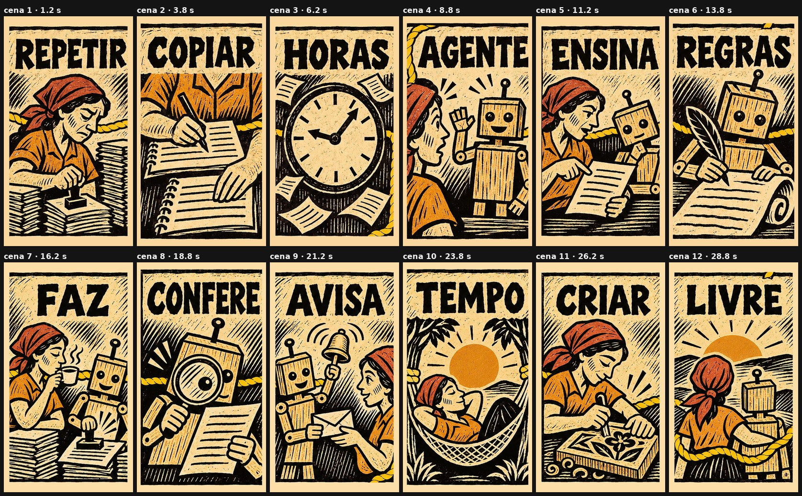

# estilo em skill: todo vêƒÂ­deo seu no mesmo estilo, sêƒÂ³ trocando o tema

[](https://linnoff88-dev.github.io/

**ê°Å¸â€¡Â§ê°Å¸â€¡Â· [PortuguêƒÂªs](README.md) ê‚· ê°Å¸â€¡Âºê°Å¸â€¡Â¸ [English](README.en.md) ê‚· ê°Å¸â€¡Âªê°Å¸â€¡Â¸ [EspaêƒÂ±ol](README.es.md)**

## O que êƒÂ©

VocêƒÂª vêƒÂª um vêƒÂ­deo com um estilo visual que adora, tenta repetir e cada vêƒÂ­deo seu sai com uma cara diferente. O **estilo em skill** êƒÂ© um kit grêƒÂ¡tis que estuda a linguagem visual desse vêƒÂ­deo (cores, letras, composiêƒÂ§êƒÂ£o, movimento) e guarda tudo numa skill, um arquivo de instruêƒÂ§êƒÂµes que o Claude Code ou o Codex segue. Depois vocêƒÂª diz sêƒÂ³ o tema, e a skill faz o vêƒÂ­deo inteiro com a mesma cara: storyboard, cenas animadas, narraêƒÂ§êƒÂ£o numa voz sêƒÂ³, uma trilha e uma conferêƒÂªncia antes de dizer "pronto". êƒâ€° para quem cria vêƒÂ­deo curto e nêƒÂ£o programa; vocêƒÂª precisa do Claude Code ou do Codex, de uma ferramenta que gere imagem e de trêƒÂªs programas grêƒÂ¡tis no computador.

## ê°Å¸â€œâ€“ Guia de uso

Guia completo (landing + passo a passo): **https://linnoff88-dev.github.io/

ê°Å¸Å½Â¬ VêƒÂ­deo: https://www.youtube.com/watch?v=bphIJzdykNU ê‚· Short: https://youtube.com/shorts/mSEYJ8zA-zU



## Como funciona

Um kit aberto que transforma o **estilo** (nêƒÂ£o o conteêƒÂºdo) de um vêƒÂ­deo de referêƒÂªncia numa **skill**
reutilizêƒÂ¡vel. Depois de instalada, vocêƒÂª dêƒÂ¡ sêƒÂ³ cinco dados (tema, formato, duraêƒÂ§êƒÂ£o, resoluêƒÂ§êƒÂ£o e motor) e a
skill planeja as cenas, desenha o storyboard no estilo, escreve a narraêƒÂ§êƒÂ£o, anima, pêƒÂµe uma trilha êƒÂºnica e
entrega `final/video-final.mp4` + `final/manifesto.json`, **conferidos por um script** antes de dizer "pronto".

**vêƒÂ­deo de referêƒÂªncia ê¢â€ â€™ quadros escolhidos sozinhos ê¢â€ â€™ a IA escreve a "bêƒÂ­blia do estilo" ê¢â€ â€™ skill instalada
ê¢â€ â€™ storyboard (atêƒÂ© 6 cenas de 2,5 s) ê¢â€ â€™ cenas animadas ê¢â€ â€™ narraêƒÂ§êƒÂ£o numa voz sêƒÂ³ ê¢â€ â€™ trilha êƒÂºnica ê¢â€ â€™ vêƒÂ­deo + manifesto + validaêƒÂ§êƒÂ£o**

## Para quem

Para quem cria vêƒÂ­deo (reels, shorts, explicativos), tem 30+ anos, nêƒÂ£o êƒÂ© programador e jêƒÂ¡ usa o
**Claude Code** ou o **Codex**. VocêƒÂª nêƒÂ£o precisa escrever cêƒÂ³digo: copia comandos e conversa com a IA.

## O que vocêƒÂª precisa

| o quêƒÂª | para quêƒÂª | como conferir |
|---|---|---|
| Claude Code **ou** Codex | ver os quadros, escrever a bêƒÂ­blia, rodar a skill, gerar o storyboard | abrir no terminal |
| ffmpeg (traz o ffprobe) | cortar, animar, juntar, medir o êƒÂ¡udio | `ffmpeg -version` |
| Python 3 | rodar os scripts | `python3 --version` |
| Pillow | mexer nas imagens | `python3 -c "import PIL"` (instalar no Ubuntu: `sudo apt install python3-pil`; no Mac: `brew install pillow`) |
| uma voz | narraêƒÂ§êƒÂ£o | vocêƒÂª grava, ou um TTS local (opcional: edge-tts) |
| uma mêƒÂºsica sua ou com licenêƒÂ§a | trilha | um `.mp3`/`.wav` |

Para o storyboard vocêƒÂª precisa de uma ferramenta que gere imagem (no Codex, a `image_gen` da assinatura).

## O processo, do inêƒÂ­cio ao fim

Legenda: ê°Å¸Â§Â  vocêƒÂª com a IA ê‚· ê¢Å¡â„¢ê¯Â¸Â script ê‚· ê°Å¸Â¤â€“ a skill (a IA seguindo o `SKILL.md`)

| # | passo | comando | quem |
|---|---|---|---|
| 1 | Escolha o vêƒÂ­deo de referêƒÂªncia (o estilo que vocêƒÂª quer) | ê¢â‚¬â€ | ê°Å¸Â§Â  |
| 2 | Tirar 5ê¢â‚¬â€œ8 quadros diferentes + folha de contato | `python3 scripts/quadros.py ref.mp4 --n 8 --saida estilo/quadros/` | ê¢Å¡â„¢ê¯Â¸Â |
| 3 | A IA olha os quadros e escreve a bêƒÂ­blia do estilo (paleta em hex, tipografia, composiêƒÂ§êƒÂ£o, o que nêƒÂ£o fazerê¢â‚¬Â¦) | colar `prompts/criar-skill.md` no Claude Code/Codex | ê°Å¸Â§Â  |
| 4 | Instalar a skill com a bêƒÂ­blia | `bash scripts/instalar.sh meu-estilo claude --estilo estilo/estilo.md` (ou `codex`) | ê¢Å¡â„¢ê¯Â¸Â |
| 5 | Pedir o vêƒÂ­deo: tema, formato, duraêƒÂ§êƒÂ£o, resoluêƒÂ§êƒÂ£o, motor | "use a skill meu-estilo para um vêƒÂ­deo sobre ê¢â‚¬Â¦" | ê°Å¸Â§Â  |
| 6 | Calcular cenas e storyboards ê¢â€ â€™ `saida/plano.json` | `cenas.py --tema ê¢â‚¬Â¦ --duracao 30 --formato 9:16` | ê°Å¸Â¤â€“ê¢Å¡â„¢ê¯Â¸Â |
| 7 | Escrever o roteiro (fala de atêƒÂ© 6 palavras por cena, palavra-chave por cena) | `roteiro.json` + `cenas.py ê¢â‚¬Â¦ --roteiro roteiro.json` | ê°Å¸Â¤â€“ |
| 8 | Montar o pedido de cada storyboard a partir do molde + bêƒÂ­blia | `pedido_storyboard.py` | ê¢Å¡â„¢ê¯Â¸Â |
| 9 | Gerar os storyboards, um por vez (o 2ꂺ recebe o 1ꂺ como referêƒÂªncia), e OLHAR cada um | ferramenta de imagem ê¢â€ â€™ `saida/storyboards/storyboard-N.png` | ê°Å¸Â¤â€“ê°Å¸Â§Â  |
| 10 | Cortar em painêƒÂ©is no formato do vêƒÂ­deo | `recortar.py --plano saida/plano.json` | ê¢Å¡â„¢ê¯Â¸Â |
| 11 | Animar (motor local: zoom/pan lento + dissolve) | `animar.py` | ê¢Å¡â„¢ê¯Â¸Â |
| 12 | NarraêƒÂ§êƒÂ£o numa voz sêƒÂ³, encaixada nas cenas | `narrar.py --arquivo voz.wav` (ou `--falas-dir`, `--comando`, `--ARCKHê‰vox`) | ê¢Å¡â„¢ê¯Â¸Â |
| 13 | Trilha êƒÂºnica com ducking + vêƒÂ­deo final + manifesto | `montar.py` | ê¢Å¡â„¢ê¯Â¸Â |
| 14 | Conferir de verdade e olhar a folha final | `validar.py --duracao 30 --resolucao 1080x1920` e `folha.py` | ê¢Å¡â„¢ê¯Â¸Âê°Å¸Â§Â  |
| 15 | Melhorar a skill com o que deu errado | anotar em `references/licoes.md` e mudar a regra | ê°Å¸Â§Â  |

Os comandos dos passos 6 a 14 ficam em `<skill>/scripts/` (ex.: `.claude/skills/meu-estilo/scripts/`).
A skill roda tudo isso sozinha; a tabela êƒÂ© para vocêƒÂª saber o que acontece e conseguir rodar êƒÂ  mêƒÂ£o.

## Cenas e storyboards

Cada cena dura **2,5 s**; cada storyboard tem **atêƒÂ© 6 cenas** (15 s). Mais longo = vêƒÂ¡rios storyboards,
gerados um de cada vez para manter a continuidade. DuraêƒÂ§êƒÂ£o que nêƒÂ£o êƒÂ© mêƒÂºltiplo de 2,5 vai para o mais
prêƒÂ³ximo, com aviso (17 s ê¢â€ â€™ 17,5 s).

| duraêƒÂ§êƒÂ£o | cenas | storyboards | grade (9:16) |
|---|---|---|---|
| 10 s | 4 | 1 | 2 êƒâ€” 2 |
| 15 s | 6 | 1 | 2 êƒâ€” 3 |
| 20 s | 8 | 2 | 2 êƒâ€” 2 + 2 êƒâ€” 2 |
| 30 s | 12 | 2 | 2 êƒâ€” 3 + 2 êƒâ€” 3 |
| 45 s | 18 | 3 | 2 êƒâ€” 3 êƒâ€” 3 |

Em 16:9 a grade cheia êƒÂ© 3 linhas êƒâ€” 2 colunas (a folha fica quase quadrada nos dois casos).

## Motores

| motor | estado | o que faz |
|---|---|---|
| `local` | **testado** | grêƒÂ¡tis, sem IA de vêƒÂ­deo: cada painel ganha um movimento de cêƒÂ¢mera lento (zoom atêƒÂ© 1,25êƒâ€”, pan) e as cenas se ligam por dissolve, na duraêƒÂ§êƒÂ£o exata |
| `kling` | **nêƒÂ£o testado neste kit** | `animar.py --motor kling --so-prompts` escreve os comandos `kling image_to_video` de cada cena para vocêƒÂª rodar na SUA conta |
| `seedance` / `higgsfield` | **nêƒÂ£o testado neste kit** | `animar.py --motor seedance --so-prompts` escreve um prompt por storyboard (tempo de cada cena, cêƒÂ¢mera, texto, transiêƒÂ§êƒÂ£o, fala, "sem mêƒÂºsica") para colar no site |

O kit nêƒÂ£o chama nenhuma API. Nos motores de IA, quem roda êƒÂ© vocêƒÂª, na sua conta.

## O que o kit garante (e testa)

- `quadros.py` escolhe quadros **diferentes** sozinho: troca de cena do ffmpeg + descarte de parecidos
  (desenho e cor); vêƒÂ­deo com poucas trocas cai para quadros espaêƒÂ§ados.
- `recortar.py` acha a calha entre os painêƒÂ©is (clara ou escura, mesmo com o fio condutor cruzando) e, se nêƒÂ£o
  achar, corta em grade fixa; aceita grade parcial; pêƒÂµe respiro para o zoom nêƒÂ£o cortar a palavra.
- `animar.py` nêƒÂ£o encurta o vêƒÂ­deo com o dissolve (30 s pedidos = 30 s entregues).
- `narrar.py` corta silêƒÂªncio das pontas, acelera atêƒÂ© 15% se precisar, avisa quando a fala nêƒÂ£o cabe e **recusa voz muda**.
- `montar.py` usa UMA trilha do comeêƒÂ§o ao fim (nêƒÂ£o reinicia), volume 0,5, abaixa sob a voz (ducking), fade no fim;
  sem trilha ele para e pergunta; com vêƒÂ¡rias, pede para escolher.
- `validar.py` confere arquivos do manifesto, duraêƒÂ§êƒÂ£o ꂱ0,5 s, resoluêƒÂ§êƒÂ£o, vêƒÂ­deo + êƒÂ¡udio, êƒÂ¡udio e narraêƒÂ§êƒÂ£o que
  nêƒÂ£o sêƒÂ£o silêƒÂªncio, trilha presente e `status: completo`. Se algo falha, sai com erro e diz o que falta.

Testes: `bash tests/rodar.sh` (sem pytest; imagens sintêƒÂ©ticas e tons senoidais no lugar de voz e mêƒÂºsica; 24/24 passando no Ubuntu).

O kit foi feito e testado no Linux (Ubuntu). No Mac nêƒÂ£o foi testado: o `scripts/instalar.sh` usa o `sed -i` do Linux e o `tests/rodar.sh` usa `timeout`; para instalar a skill no Mac, siga o caminho manual do guia (passo 4).

## A demo: cordel

Para nêƒÂ£o usar quadro de vêƒÂ­deo de ninguêƒÂ©m, o estilo de referêƒÂªncia da demo êƒÂ© **prêƒÂ³prio**: 6 quadros de
xilogravura de cordel (papel creme, preto chapado, ocre e vermelho terroso, letras entalhadas e um fio
amarelo que liga as cenas) gerados para este kit e juntados num vêƒÂ­deo curto
(`exemplos/cordel/referencia/referencia.mp4`). DaêƒÂ­ o fluxo inteiro rodou:

- `estilo/quadros/` + `folha.jpg`: os quadros que o `quadros.py` escolheu sozinho
- `estilo/estilo.md`: a bêƒÂ­blia preenchida com o prompt do kit
- `skill/`: a skill `cordel` instalada
- `saida/storyboards/`: os 2 storyboards (e os pedidos montados pela skill), `saida/paineis/`: os 12 painêƒÂ©is
- `saida/plano.json`, `final/manifesto.json`, `final/video-final.mp4`, `final/folha-final.jpg`
- `LICOES.md`: o que deu errado entre as tentativas e o que mudou na skill

Tema: "Como um agente de IA tira o trabalho repetido do seu dia" ê¢â‚¬â€ 30 s, 9:16, 1080êƒâ€”1920, 12 cenas,
2 storyboards, motor local, voz local, trilha prêƒÂ³pria.

Resultado (conferido pelo `validar.py`):

```
  ok   manifesto com status completo
  ok   30 arquivos do manifesto existem
  ok   duraêƒÂ§êƒÂ£o 30.00 s (pedido 30 s ꂱ 0,5)
  ok   resoluêƒÂ§êƒÂ£o 1080x1920
  ok   êƒÂ¡udio do vêƒÂ­deo com som (mêƒÂ©dia -20.2 dB, pico -3.9 dB)
  ok   narraêƒÂ§êƒÂ£o com voz (mêƒÂ©dia -18.9 dB)
PASSOU: vêƒÂ­deo conferido, pode dizer pronto.
```

- MP4: 30,0 s, 1080êƒâ€”1920, 30 fps, H.264 + AAC, 23 MB. Render local (motor `local`): 78 s nesta mêƒÂ¡quina.
- Voz: TTS local (chatterbox, clonando uma voz de referêƒÂªncia), 12 falas, nenhuma passando da cena. A voz
  local êƒÂ s vezes inventa um pedaêƒÂ§o depois da frase: o `narrar.py` refez falas longas demais, cortou caudas
  baixas e a cena 3 foi refeita sozinha com `--refazer 3`. As 12 frases, conferidas com uma transcriêƒÂ§êƒÂ£o local
  (Whisper, `saida/voz/transcricao-conferencia.srt`), batem com o roteiro.
- Trilha: `assets/trilha/energia.mp3` (prêƒÂ³pria), volume 0,5, abaixando sob a voz.
- No repositêƒÂ³rio ficam os painêƒÂ©is em JPG (`paineis-jpg/`); os PNG, clipes e o vêƒÂ­deo mudo sêƒÂ£o gerados de novo
  ao rodar. Por isso, num clone, confira com `python3 skill/scripts/validar.py --sem-intermediarios`.

## Melhore a skill depois de cada teste

A skill nêƒÂ£o nasce pronta. Depois de cada vêƒÂ­deo, olhe a folha final e anote em `references/licoes.md` o que
saiu errado. Se o erro voltar, **mude a regra** (na bêƒÂ­blia, nas regras do storyboard ou no script), nêƒÂ£o sêƒÂ³ o
pedido. Na demo, pedir "palavra com no mêƒÂ¡ximo 60% da largura" nêƒÂ£o adiantou duas vezes; a correêƒÂ§êƒÂ£o que
funcionou foi no script (`--respiro`). Veja `exemplos/cordel/LICOES.md`.

## Limites honestos

- **ResoluêƒÂ§êƒÂ£o do storyboard**: a ferramenta de imagem entrega cerca de 1254êƒâ€”1254 por storyboard; cada painel
  sai com uns 370êƒâ€”600 px e êƒÂ© ampliado para 1080êƒâ€”1920. Estilos chapados (gravura, recorte, flat) aguentam bem;
  estilos com muito detalhe fino ficam moles.
- **Texto desenhado** depende da ferramenta de imagem: confira cada palavra com zoom. Palavras curtas e sem
  acento erram menos.
- **Motor local nêƒÂ£o anima o desenho**: êƒÂ© cêƒÂ¢mera passeando pela ilustraêƒÂ§êƒÂ£o + dissolve. Para personagem se
  mexendo de verdade, use um motor de IA de vêƒÂ­deo (nêƒÂ£o testado aqui).
- **edge-tts** usa um serviêƒÂ§o online e nêƒÂ£o foi testado neste kit; a demo usou TTS local. O modo `--ARCKHê‰vox`
  chama o `tts_direct.py` de uma instalaêƒÂ§êƒÂ£o local do ARCKHê‰vox; a API HTTP dele (porta 8010) nêƒÂ£o estêƒÂ¡ implementada.
- **Voz local inventa som**: o corte de cauda êƒÂ© conservador (sêƒÂ³ tira o que êƒÂ© bem mais baixo ou muito curto).
  Um "som" alto sem palavra depois da frase sêƒÂ³ êƒÂ© pego ouvindo ou transcrevendo; aêƒÂ­ use `--refazer N`.
- **Continuidade** entre storyboards êƒÂ© pedida (o anterior vai como referêƒÂªncia), mas nêƒÂ£o êƒÂ© garantida: confira.
- A bêƒÂ­blia êƒÂ© escrita pela IA olhando quadros: confira as cores e o "o que nêƒÂ£o fazer" antes de usar.
- Use sêƒÂ³ referêƒÂªncias e mêƒÂºsicas que vocêƒÂª pode usar. O mêƒÂ©todo copia a linguagem visual, nêƒÂ£o personagens, logos
  ou textos.

## Estrutura

```
scripts/quadros.py, scripts/instalar.sh      ê¢â€ Â passo 2 e 4
prompts/criar-skill.md                       ê¢â€ Â passo 3
molde/estilo-em-skill/                       ê¢â€ Â a skill (SKILL.md, references/, modelos/, scripts/)
tests/rodar.sh                               ê¢â€ Â testes
exemplos/cordel/                             ê¢â€ Â a demo completa
```

## LicenêƒÂ§a

MIT ê‚© 2026 ARCKHê‰

---

Projeto adaptado da comunidade ARCKHê‰ TDS - ARCKHÉe